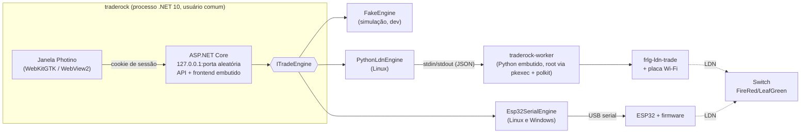

# TradeRock

Troque Pokémon com **Pokémon FireRed e LeafGreen do Nintendo Switch / Switch 2** usando o
wireless local do jogo (LDN). O seu PC, ou uma plaquinha ESP32, finge ser um segundo Switch na
sala de troca do Direct Corner.

> **Estado:** em desenvolvimento (Entrega 7 de 11). Já dá para **criar Pokémon legais** no app,
> organizá-los no **cofre** (caixas, tags, busca, exportação, injeção em `.sav` de GBA), fazer o
> assistente de troca de ponta a ponta em **modo demonstração** (motor simulado) e seguir o
> **assistente de configuração**, que confere o sistema, a placa Wi-Fi ou o ESP32 e o `prod.keys`.
> O motor com a **placa Wi-Fi** (worker + polkit + frlg-ldn-trade) e o **teste com o Switch** (a sala é
> encontrada e decifrada, sem entrar nela) estão prontos, mas **ainda não foram testados com um Switch
> de verdade**. Veja [docs/dev-host.md](docs/dev-host.md).

O TradeRock nunca baixa, sugere fontes nem distribui `prod.keys` ou ROMs. Use só as chaves
extraídas do seu próprio console.

## Plataformas

| Sistema | Motor de troca | Situação |
| --- | --- | --- |
| Linux x64 (AppImage, .deb) | Placa Wi-Fi do PC (padrão) ou ESP32 via USB | Fase 1 |
| Windows x64 (instalador) | Só ESP32 via USB | Fase 2 |

No Windows, a placa Wi-Fi do PC não serve: o sistema não dá o acesso de baixo nível ao Wi-Fi
que o LDN exige.

## Arquitetura



- **Segurança local:** o servidor só escuta em `127.0.0.1`, recusa cabeçalhos `Host` desconhecidos
  (proteção contra DNS rebinding) e exige um token de sessão aleatório. A janela recebe o token na
  URL inicial, que o servidor troca por um cookie `HttpOnly; SameSite=Strict`. O app principal
  nunca roda como root.
- **Motores externos** entram como submódulos git em `engines/`, sem copiar código:
  - [`tornadus/frlg-ldn-trade`](https://github.com/tornadus/frlg-ldn-trade): motor Python (placa Wi-Fi).
  - [`easyworld/frlg-ldn-trade-esp32`](https://github.com/easyworld/frlg-ldn-trade-esp32): core C# e firmware ESP32.
  - [`santacrab2/PKHeX-Plugins`](https://github.com/santacrab2/PKHeX-Plugins): PKHeX.Core.AutoMod.

  O frlg-ldn-trade recebe dois patches do FRLG-LDN-Trade-Console na hora do build
  ([engines/patches](engines/patches/frlg-ldn-trade/README.md)); o submódulo fica intocado.
- **Worker privilegiado** (só com a placa Wi-Fi): um processo Python separado, iniciado via `pkexec`
  com a política polkit do TradeRock. A senha de administrador é pedida pelo sistema, uma vez por
  sessão do app; o TradeRock nunca a vê. App e worker conversam pela entrada/saída padrão do processo
  (só quem o iniciou fala com ele); quando o app fecha ou trava, o worker cancela a troca, devolve a
  placa ao estado anterior (Wi-Fi ligado e gerenciado pelo NetworkManager, se era assim) e sai. Os
  arquivos (`.pk3` e `prod.keys`) chegam como bytes: o worker nunca abre caminhos vindos do app.

## Estrutura

```
app/TradeRock.App/       executável: servidor + janela
app/TradeRock.Core/      domínio: troca (coordenador, motores), Pokémon (PKHeX), armazenamento (SQLite)
app/TradeRock.Tests/     testes (xUnit v3)
catalog/                 catálogo de placas Wi-Fi, ESP32 e conversores USB-serial (JSON)
worker/                  worker privilegiado (Linux, Python): protocolo, rádio, wrapper do motor
frontend/                React + Vite + TypeScript + Tailwind
engines/                 submódulos (motores e AutoMod)
firmware/                firmware ESP32 embutido (vem do submódulo do easyworld)
content/                 textos explicativos em markdown, por idioma
packaging/               AppImage, .deb, polkit, instalador Windows
docs/                    decisões e guias de desenvolvimento
```

## Desenvolvimento

Clone com os submódulos:

```bash
git clone --recurse-submodules <url>
# ou, num clone existente:
git submodule update --init
```

### Opção 1: Dev Container (VS Code)

Abra a pasta no VS Code e escolha **Reopen in Container**. A imagem (`.devcontainer/Dockerfile`)
traz .NET 10, Node LTS, Python 3.12, esptool e as dependências de empacotamento. É a mesma
imagem usada no CI.

### Opção 2: docker compose (hot reload)

```bash
docker compose -f docker-compose.dev.yml up --build
```

Abra <http://localhost:5173>. O backend roda com `dotnet watch` e o Vite repassa `/api` para ele
com um token fixo de desenvolvimento. Só a porta do Vite é publicada, e só em `127.0.0.1`.

### Opção 3: direto no host (Linux)

Precisa do .NET 10 SDK, do Node 24 e das bibliotecas da janela:

```bash
sudo apt install libwebkit2gtk-4.1-0 libnotify4   # Debian/Ubuntu
scripts/dev-host.sh
```

Para o motor com a placa Wi-Fi real, este é o **único** caminho. Veja [docs/dev-host.md](docs/dev-host.md).

### Comandos úteis

```bash
scripts/ci.sh                                  # build + todos os testes (igual ao CI)
dotnet run --project app/TradeRock.App -- --no-window   # só servidor; imprime a URL com o token
cd frontend && npm run dev                     # Vite; backend em --no-window --port 5080 (perfil do launchSettings)
```

Opções do executável:

| Opção | Efeito |
| --- | --- |
| `--no-window` | Só o servidor. A URL de acesso (com o token) sai no terminal. |
| `--port N` | Porta fixa (padrão: aleatória). |
| `--data-dir DIR` | Pasta de dados alternativa. |
| `--dev-tools` | Ferramentas de desenvolvedor e menu de contexto na janela. |
| `--bind ADDR` | Só no ambiente `Development` (containers). Fora dele, apenas loopback. |

### ESP32 dentro do container

Repasse a porta serial para o container:

- **Dev Container:** descomente `runArgs` em `.devcontainer/devcontainer.json`, por exemplo
  `"--device=/dev/ttyUSB0"` (ou `/dev/ttyACM0` em placas com USB nativo).
- **docker compose:** descomente `devices` no serviço `backend`.

O usuário `dev` do container já está no grupo `dialout`. No host, confira qual porta apareceu
com `ls /dev/ttyUSB* /dev/ttyACM*` depois de conectar a placa.

### Construtor de Pokémon

Em **Criar Pokémon**, escolha a espécie e o que quiser dela (nível, natureza, habilidade, gênero,
shiny, IVs, EVs, golpes, item, Poké Bola, idioma, origem, treinador original). O TradeRock usa o
**PKHeX.Core.AutoMod** para gerar uma versão legal e o **LegalityAnalysis do PKHeX** para conferir,
a cada mudança. Quando algo não é possível, a tela mostra o que mudou ou o que impede.

- **Modo avançado:** edição dos campos brutos (PID, IVs, local de encontro…), como no PKHeX.
- **Importar:** texto do Showdown, `.pk3`/`.ek3` e `.sav` de GBA (time e caixas).
- **Meu treinador** (Configurações): dados do seu save, usados como OT padrão e nos avisos de
  obediência e de Pokédex Nacional.
- Pokémon ilegal não vai para o Switch, a não ser no modo avançado de troca, com confirmação.

### Cofre

- **Caixas de 30 posições**, como no jogo. Pokémon novos chegam na **Caixa de entrada**.
- Arraste para mudar de posição ou de caixa. Soltar numa posição ocupada troca os dois de lugar.
- **Busca** (espécie, número, apelido, treinador) e **filtros**: legalidade, origem, nível, shiny,
  avisos, possíveis duplicatas e tags.
- **Tags** com cor, também aplicadas em lote.
- **Lixeira** recuperável. Esvaziar a lixeira mantém os Pokémon que estão no histórico de trocas.
- **Exportar** `.pk3`/`.ek3`, com 100 ou 80 bytes. Na janela do app, o sistema pergunta onde salvar.
  No navegador, o arquivo é baixado (vários de uma vez viram `.zip`).
- **Injetar num `.sav`** de GBA:
  - só em posições vazias;
  - a Pokédex do save é atualizada;
  - um backup do original vai para `backups/` na pasta de dados;
  - o resultado é relido e conferido pelo PKHeX.

  Na janela do app, o arquivo é alterado no mesmo lugar. No navegador, você baixa o save novo.
- Solte `.pk3`/`.ek3`/`.sav` em qualquer lugar da janela para importar.

### Assistente de configuração

Na primeira execução, a tela inicial leva ao assistente (`/configurar`, também em Configurações).
São 7 etapas: boas-vindas, `prod.keys`, escolha do rádio, preparo do rádio, preparo do jogo,
teste com o Switch e resumo. O app lê o sistema sem pedir senha:
- distribuição, WSL ou máquina virtual;
- placas Wi-Fi (`/sys/class/ieee80211`) e qual delas leva a internet;
- portas seriais e o conversor USB de cada uma;
- grupos do usuário (`dialout` ou `uucp`) e o `brltty`.

Depois compara com o [catálogo](catalog/hardware-catalog.json). Cada item do catálogo cita a fonte
(README, issue ou PR dos motores) e a data da conferência. As placas sem relato aparecem como
"não testado". Quando falta algo, o app mostra o comando para resolver, mas nunca o executa com
privilégios.

O **relatório** exportado no resumo serve para pedir ajuda. Ele não inclui chaves, nome de
usuário nem caminhos pessoais.

Com a placa Wi-Fi, a etapa 4 faz o **teste real da placa**: modo monitor e transmissão de quadros de
ação nos canais 1, 6 e 11, pela mesma biblioteca LDN da troca, sem Switch nem prod.keys. Ela também
oferece **configurar o NetworkManager**, que cria `/etc/NetworkManager/conf.d/zz-ldn-unmanaged.conf`
e `/etc/systemd/network/10-traderock-ldn.link`, sempre com confirmação.

A etapa 6 faz o **teste com o Switch**: com a sala do Direct Corner aberta como Leader, o app escuta
os anúncios da sala por até 30 segundos e tenta decifrá-los com o `prod.keys`, sem entrar na sala.
O resultado diz se a sala foi encontrada e decifrada (rádio e chaves confirmados), encontrada mas
não decifrada (chaves erradas), se só apareceu outro jogo ou se nada foi encontrado. Com a placa
Wi-Fi, esse teste é **essencial**: a troca só é liberada depois dele, e ele precisa ser refeito quando
a placa ou o `prod.keys` mudam. Com o ESP32, o teste chega junto com o motor, na Entrega 9, e até lá
aparece como "em breve".

Em desenvolvimento (`ASPNETCORE_ENVIRONMENT=Development`), um seletor no topo do assistente simula
9 cenários: Linux com placa compatível, instável, desconhecida ou problemática, sem Wi-Fi, WSL,
máquina virtual, Linux com ESP32 e Windows com ESP32.

### Modo demonstração

Sem Switch, placa ou prod.keys, o TradeRock usa o **FakeEngine**, que simula a troca inteira no
ritmo real. Na etapa "Jogo e treinador" dá para escolher o que o Switch simulado faz: dar certo,
falhar algumas vezes antes de conectar, chaves erradas, cancelar a troca etc. Para acelerar a
simulação em desenvolvimento, use `--Engines:Fake:SpeedFactor=0.2` (0 = instantâneo).

Na primeira execução, o app já traz dois Pokémon de demonstração (MEWTWO e DEOXYS, do repositório
do easyworld). Detalhes do fluxo em [docs/trade-flow.md](docs/trade-flow.md).

## Pastas de dados

| Sistema | Pasta |
| --- | --- |
| Linux | `$XDG_DATA_HOME/traderock` (padrão `~/.local/share/traderock`) |
| Windows | `%APPDATA%\TradeRock` |

Dentro dela:

| Pasta ou arquivo | Conteúdo |
| --- | --- |
| `traderock.db` | Banco SQLite |
| `vault/` | Arquivos `.pk3`, nomeados pelo SHA-256 |
| `backups/` | Cópias dos saves antes de qualquer injeção |
| `keys/` | `prod.keys` (pasta com permissão 700, arquivo 600) |
| `logs/` | Logs do app |

Migrações do banco: `dotnet tool restore && dotnet ef migrations add <Nome> --project app/TradeRock.Core --output-dir Storage/Migrations`.

## Solução de problemas

**"Não foi possível abrir a janela do TradeRock: faltam bibliotecas do sistema"**
Instale o WebKitGTK 4.1 e o libnotify (o comando aparece na mensagem) ou rode com `--no-window`.

**Minha placa Wi-Fi serve?** Abra o assistente em Configurações. A etapa "Escolher o rádio"
mostra a sua placa e a tabela de placas conhecidas. No WSL ou numa máquina virtual, a placa Wi-Fi
não fica acessível: use um ESP32 ou o Linux instalado de verdade.

**O ESP32 não aparece / "permissão negada" na porta.** Use um cabo USB de dados e adicione o seu
usuário ao grupo `dialout` (Arch: `uucp`), depois saia e entre de novo na sessão. Se o `brltty`
estiver rodando e você não usa display braile, desative-o. O assistente mostra os comandos exatos.

## Licença e créditos

TradeRock é software livre sob a **GNU AGPL-3.0**. Veja [LICENSE](LICENSE) e
[THIRD-PARTY-NOTICES.md](THIRD-PARTY-NOTICES.md).
