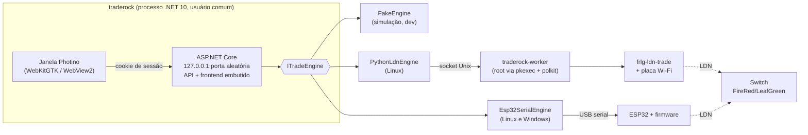

# TradeRock

Troque Pokémon com **Pokémon FireRed e LeafGreen do Nintendo Switch / Switch 2** usando o
wireless local do jogo (LDN). O seu PC, ou uma plaquinha ESP32, finge ser um segundo Switch na
sala de troca do Direct Corner.

> **Estado:** em desenvolvimento (Entrega 1 de 11: base do aplicativo). Ainda não troca Pokémon.

O TradeRock nunca baixa, sugere fontes nem distribui `prod.keys` ou ROMs. Use só as chaves
extraídas do seu próprio console.

## Plataformas

| Sistema | Motor de troca | Situação |
| --- | --- | --- |
| Linux x64 (AppImage, .deb) | Placa Wi-Fi do PC (padrão) ou ESP32 via USB | Fase 1 |
| Windows x64 (instalador) | Só ESP32 via USB | Fase 2 |

No Windows, a placa Wi-Fi do PC não serve: o sistema não dá o acesso de baixo nível ao Wi-Fi
que o LDN exige.

## Arquitetura



- **Segurança local:** o servidor só escuta em `127.0.0.1`, recusa cabeçalhos `Host` desconhecidos
  (proteção contra DNS rebinding) e exige um token de sessão aleatório. A janela recebe o token na
  URL inicial, que o servidor troca por um cookie `HttpOnly; SameSite=Strict`. O app principal
  nunca roda como root.
- **Motores externos** entram como submódulos git em `engines/`, sem copiar código:
  - [`tornadus/frlg-ldn-trade`](https://github.com/tornadus/frlg-ldn-trade): motor Python (placa Wi-Fi).
  - [`easyworld/frlg-ldn-trade-esp32`](https://github.com/easyworld/frlg-ldn-trade-esp32): core C# e firmware ESP32.
  - [`santacrab2/PKHeX-Plugins`](https://github.com/santacrab2/PKHeX-Plugins): PKHeX.Core.AutoMod.

## Estrutura

```
app/TradeRock.App/       executável: servidor + janela
app/TradeRock.Core/      domínio e abstrações de plataforma
app/TradeRock.Tests/     testes (xUnit v3)
worker/TradeRock.Worker/ worker privilegiado (Linux)
frontend/                React + Vite + TypeScript + Tailwind
engines/                 submódulos (motores e AutoMod)
firmware/                firmware ESP32 embutido (vem do submódulo do easyworld)
content/                 textos explicativos em markdown, por idioma
packaging/               AppImage, .deb, polkit, instalador Windows
docs/                    decisões e guias de desenvolvimento
```

## Desenvolvimento

Clone com os submódulos:

```bash
git clone --recurse-submodules <url>
# ou, num clone existente:
git submodule update --init
```

### Opção 1: Dev Container (VS Code)

Abra a pasta no VS Code e escolha **Reopen in Container**. A imagem (`.devcontainer/Dockerfile`)
traz .NET 10, Node LTS, Python 3.12, esptool e as dependências de empacotamento. É a mesma
imagem usada no CI.

### Opção 2: docker compose (hot reload)

```bash
docker compose -f docker-compose.dev.yml up --build
```

Abra <http://localhost:5173>. O backend roda com `dotnet watch` e o Vite repassa `/api` para ele
com um token fixo de desenvolvimento. Só a porta do Vite é publicada, e só em `127.0.0.1`.

### Opção 3: direto no host (Linux)

Precisa do .NET 10 SDK, do Node 24 e das bibliotecas da janela:

```bash
sudo apt install libwebkit2gtk-4.1-0 libnotify4   # Debian/Ubuntu
scripts/dev-host.sh
```

Para o motor com a placa Wi-Fi real, este é o **único** caminho. Veja [docs/dev-host.md](docs/dev-host.md).

### Comandos úteis

```bash
scripts/ci.sh                                  # build + todos os testes (igual ao CI)
dotnet run --project app/TradeRock.App -- --no-window   # só servidor; imprime a URL com o token
cd frontend && npm run dev                     # Vite; backend em --no-window --port 5080 (perfil do launchSettings)
```

Opções do executável:

| Opção | Efeito |
| --- | --- |
| `--no-window` | Só o servidor. A URL de acesso (com o token) sai no terminal. |
| `--port N` | Porta fixa (padrão: aleatória). |
| `--data-dir DIR` | Pasta de dados alternativa. |
| `--dev-tools` | Ferramentas de desenvolvedor e menu de contexto na janela. |
| `--bind ADDR` | Só no ambiente `Development` (containers). Fora dele, apenas loopback. |

### ESP32 dentro do container

Repasse a porta serial para o container:

- **Dev Container:** descomente `runArgs` em `.devcontainer/devcontainer.json`, por exemplo
  `"--device=/dev/ttyUSB0"` (ou `/dev/ttyACM0` em placas com USB nativo).
- **docker compose:** descomente `devices` no serviço `backend`.

O usuário `dev` do container já está no grupo `dialout`. No host, confira qual porta apareceu
com `ls /dev/ttyUSB* /dev/ttyACM*` depois de conectar a placa.

## Pastas de dados

| Sistema | Pasta |
| --- | --- |
| Linux | `$XDG_DATA_HOME/traderock` (padrão `~/.local/share/traderock`) |
| Windows | `%APPDATA%\TradeRock` |

## Solução de problemas

**"Não foi possível abrir a janela do TradeRock: faltam bibliotecas do sistema"**
Instale o WebKitGTK 4.1 e o libnotify (o comando aparece na mensagem) ou rode com `--no-window`.

A seção de placas Wi-Fi e ESP32 chega com o catálogo de hardware (Entrega 5).

## Licença e créditos

TradeRock é software livre sob a **GNU AGPL-3.0**. Veja [LICENSE](LICENSE) e
[THIRD-PARTY-NOTICES.md](THIRD-PARTY-NOTICES.md).
